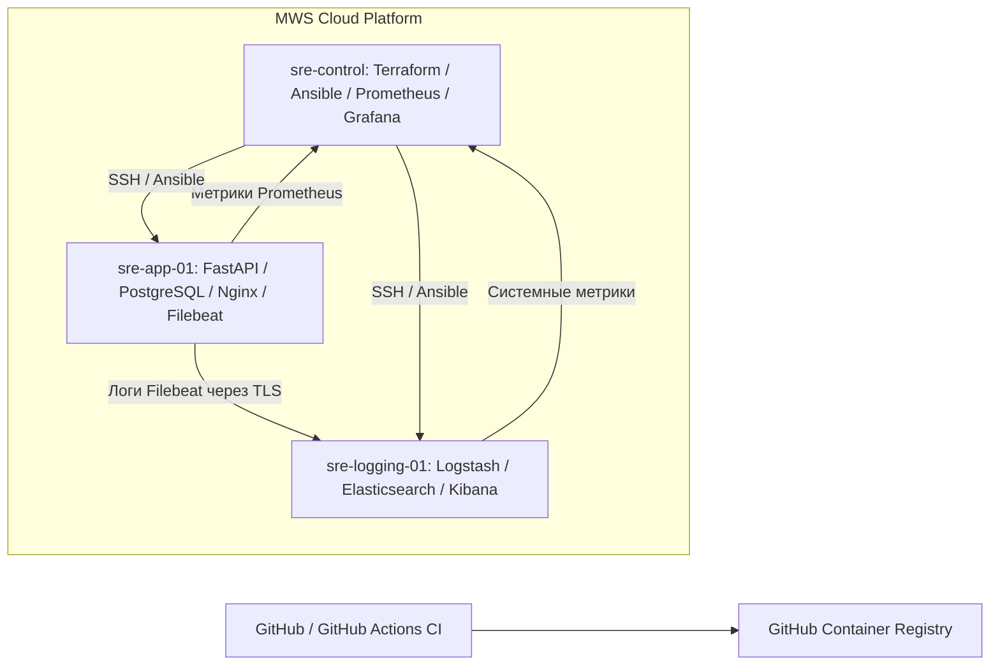

# Production SRE Lab

**Облачная лаборатория Site Reliability Engineering: инфраструктура как код, CI, наблюдаемость, диагностика отказов и автоматизация эксплуатации.**


## О проекте

**Production SRE Lab** — мой самостоятельный pet-проект, в котором я проектирую, развёртываю и эксплуатирую учебную облачную инфраструктуру, приближенную к повседневным задачам SRE/DevOps-инженера.

Проект развёрнут на **MWS Cloud Platform** и объединяет инфраструктуру как код, автоматизированную настройку Linux-серверов, контейнеризированное REST API, непрерывную интеграцию, мониторинг, централизованное логирование и практику реагирования на отказы.

Цель проекта — разобраться во взаимодействии компонентов, научиться диагностировать неисправности по метрикам и логам, автоматизировать изменения и обоснованно управлять надёжностью сервисов.

**Текущий этап — Stage 5/8 (Observability).** Основные компоненты мониторинга и ELK работают; реализованы семь правил оповещений Prometheus, настроено автоматическое удаление устаревших индексов Elasticsearch (ILM). Продолжаются эксплуатационные проверки и документирование. Следующие крупные этапы — Kubernetes, Reliability & Incidents и AI SRE Assistant.

> **Важно:** это учебная SRE-лаборатория, а не коммерческая production-система. В частности, отказоустойчивый кластер и полноценная доставка уведомлений об алертах пока не реализованы.

## Архитектура инфраструктуры

Инфраструктура разделена между тремя виртуальными машинами в частной сети MWS Cloud.

| Виртуальная машина | Ответственность | Основные компоненты |
|---|---|---|
| `sre-control` | Управление инфраструктурой и наблюдаемость | Terraform, Ansible, Prometheus, Grafana |
| `sre-app-01` | Приложение и хранилище данных | FastAPI, PostgreSQL, Nginx, Docker Compose, экспортёры, Filebeat |
| `sre-logging-01` | Централизованная обработка логов | Elasticsearch, Logstash, Kibana, Node Exporter |



**Основные потоки данных:**

- **Provisioning:** Terraform → API MWS Cloud → виртуальные машины, сеть и правила доступа.
- **Configuration Management:** Ansible на `sre-control` → конфигурация сервисов управляемых ВМ.
- **CI:** GitHub Actions (GitHub-hosted runner) → тесты FastAPI → Docker Build → публикация образа в GHCR при push в `main`.
- **Metrics:** Linux / FastAPI / PostgreSQL / Docker → экспортёры → Prometheus → Grafana.
- **Logs:** Docker / Nginx / тестовые события → Filebeat → Logstash → Elasticsearch → Kibana.
- **Alerting:** Prometheus → вычисление правил → состояния `inactive`, `pending`, `firing`. Отдельный канал доставки уведомлений пока не подключён.

Управление выполняется по SSH; внутренние интерфейсы наблюдаемости открываются через SSH-туннели. Порты мониторинга и ELK не предназначены для публикации в интернет.

## Технологический стек

| Категория | Технологии | Назначение |
|---|---|---|
| Облачная платформа | MWS Cloud Platform | ВМ, частная сеть, правила доступа, объектное хранилище |
| Infrastructure as Code | Terraform | Управление облачными ресурсами и удалённым состоянием |
| Configuration Management | Ansible | Inventory, роли, playbooks, воспроизводимая настройка |
| Приложение | Python, FastAPI | REST API с CRUD-операциями и проверкой `/ready` |
| Данные | PostgreSQL | Постоянное хранилище приложения |
| Контейнеризация | Docker, Docker Compose | Сборка и запуск приложения и зависимостей |
| Reverse Proxy | Nginx | HTTP-проксирование |
| CI и образы | GitHub Actions, GHCR | Автоматизированные тесты, сборка и публикация образов |
| Метрики | Prometheus, Grafana | Сбор, хранение и визуализация временных рядов |
| Экспортёры | Node Exporter, cAdvisor, PostgreSQL Exporter, Blackbox Exporter и другие | Метрики серверов, контейнеров, БД и HTTP-доступности |
| Логи | Filebeat, Logstash, Elasticsearch, Kibana | Доставка, обработка, хранение и поиск событий |
| ОС | Ubuntu Server 24.04 LTS | Платформа облачных серверов |

## Реализованные компоненты

### 1. Облачная инфраструктура и IaC

- Через Terraform описаны виртуальные машины, подсети, сетевые правила и необходимые облачные ресурсы.
- Terraform State хранится удалённо в объектном хранилище MWS Cloud.
- Серверы разделены по назначению; управление рабочими ВМ выполняется через `sre-control`.
- Ansible применяет базовые настройки и конфигурации наблюдаемости. Playbooks проверяются на синтаксис, где возможно — на повторяемость результата (идемпотентность).
- Сетевой доступ к административным интерфейсам ограничен; для браузерного доступа применяются локальные SSH-перенаправления портов.

### 2. FastAPI, PostgreSQL и Docker

- Реализовано Python REST API с CRUD-операциями.
- Приложение взаимодействует с PostgreSQL.
- Компоненты запускаются в контейнерах через Docker Compose; для HTTP-доступа используется Nginx.
- Доступность приложения проверяется через endpoint `/ready`, HTTP-пробы и метрики.
- Подготовлены автоматизированные unit/API-тесты и интеграционные проверки PostgreSQL.

### 3. CI/CD — текущее состояние

**Действующий CI:** workflow `.github/workflows/ci.yml` выполняется на **GitHub-hosted runners** (`ubuntu-24.04`). В него входят проверки Python, тесты с PostgreSQL, сборка Docker-образа; при push в `main` выполняется публикация образа в GitHub Container Registry.

**CD временно отключён.** Ранее развёртывание выполнялось через self-hosted GitHub Actions runner на `sre-control`. Перед подготовкой репозитория к публичному доступу:

- служба runner остановлена и отключена от автозапуска;
- регистрация runner удалена в настройках GitHub;
- workflow тестирования self-hosted runner удалён;
- прежний CD workflow перенесён в `docs/legacy-workflows/` с расширением `.disabled`.

Автоматическое развёртывание в облако **не следует считать действующим CI/CD-процессом**. Его безопасная замена — отдельная дальнейшая задача.

### 4. Мониторинг — Prometheus и Grafana

Prometheus собирает метрики приложения, базы данных, контейнеров и всех трёх Linux-серверов. Для `sre-logging-01` установлен отдельный Node Exporter, а конфигурация scrape targets хранится в Git.

В Grafana подготовлены два дашборда:

- **Production SRE Lab — Infrastructure Overview:** CPU, RAM, файловые системы и сетевой трафик ВМ; контейнеры; доступность FastAPI и PostgreSQL; состояние scrape targets.
- **Campus Wi-Fi — Overview:** дополнительный эксперимент по сбору показателей Wi-Fi с локального Windows 11 через `windows_exporter` и textfile collector.

В конфигурации Prometheus присутствуют **9 targets**. Целевое число доступных targets может меняться во время сессии: экспериментальный `campus-wifi-windows` зависит от запущенного обратного SSH-туннеля с локального компьютера. Его недоступность сама по себе не означает отказ облачного приложения.

### 5. Алертинг и проверка отказов

В Prometheus загружено и проверено через `promtool` **7 alerting rules** из `observability/prometheus/rules/sre-lab-alerts.yml`.

| Правило | Что обнаруживает |
|---|---|
| `FastAPIUnavailable` | Неуспешная HTTP-проверка FastAPI (`probe_success == 0`) |
| `BlackboxProbeUnavailable` | Невозможность получить метрики от HTTP-пробы |
| `PostgreSQLUnavailable` | Недоступность PostgreSQL по метрике экспортёра |
| `PostgreSQLExporterDown` | Недоступность самого PostgreSQL Exporter |
| `SRENodeExporterDown` | Отсутствие сбора системных метрик с одной из Linux-ВМ |
| `HighMemoryUsage` | Превышение порога использования оперативной памяти |
| `RootFilesystemAlmostFull` | Приближение к заполнению корневой файловой системы |

**Проверка в лаборатории:** проводилось контролируемое нарушение доступности FastAPI. Grafana отобразила состояние `DOWN`, а правило `FastAPIUnavailable` прошло состояния `pending` и `firing`. После восстановления HTTP-доступности алерт вернулся в `inactive`.

Таким образом, проверена не только корректность YAML, но и фактическая реакция мониторинга на отказ. **Alertmanager / внешние уведомления пока не настроены:** сейчас алерты видны в интерфейсе Prometheus.

### 6. Централизованное логирование — ELK

На `sre-logging-01` развёрнуты Elasticsearch, Logstash и Kibana. Filebeat на `sre-app-01` передаёт события в Logstash по защищённому Beats-соединению, после чего Logstash индексирует их в Elasticsearch. Наличие индексов `sre-lab-beats-*` и документов проверено через Kibana Dev Tools.

Настроено управление сроком хранения логов (**Index Lifecycle Management**):

- **ILM Policy:** `sre-lab-beats-7d`;
- **Index Template:** `sre-lab-beats-template` для `sre-lab-beats-*`;
- **Срок хранения индексов:** удаление по достижении возраста 7 дней;
- **Шаблон новых индексов:** `number_of_replicas: 0` для одноузловой лаборатории;
- **Управление настройками:** отдельный Ansible playbook и секреты через Ansible Vault.

ILM помогает ограничить рост дискового пространства и стоимость эксплуатации. При этом **удаление данных необратимо без отдельной резервной копии**, а единственный узел Elasticsearch не обеспечивает отказоустойчивость.

## Безопасность

- **Разграничение доступа:** частная облачная сеть, правила сетевого доступа и SSH для администрирования.
- **Изоляция интерфейсов:** Prometheus, Grafana, Elasticsearch и Kibana не публикуются напрямую в интернет; удалённый доступ осуществляется через SSH-туннели.
- **Шифрование:** защищённая доставка событий Filebeat → Logstash, HTTPS и аутентификация для Elasticsearch.
- **Секреты:** чувствительные данные не должны попадать в Git; для автоматизации используются Ansible Vault, keystore сервисов и локальные настройки окружения.
- **GitHub Actions:** основной CI работает на GitHub-hosted runners; публикация образов ограничена push в `main`; self-hosted runner, имевший доступ к облачной среде, отключён и удалён из GitHub.
- **Аудит перед публикацией:** проведено сканирование истории Git и рабочего дерева с помощью Gitleaks; найдено 0 совпадений в проверенных данных. Это снижает риск, но **не является доказательством полного отсутствия секретов**.

Локальные файлы состояния Terraform, приватные ключи, реальные `.env` и Ansible Vault не должны добавляться в репозиторий даже при наличии `.gitignore`. Публичное размещение репозитория допускается только после повторной проверки его содержимого и настроек доступа.

## Эксплуатационные проверки

Примеры проверок, которые использовались в лаборатории. Команды выполняются на `sre-control` после подготовки соответствующих компонентов.

```bash
# Проверить состояние Prometheus
systemctl is-active prometheus
curl -fsS http://127.0.0.1:9090/-/ready

# Проверить конфигурацию Prometheus и правила алертов
promtool check config /etc/prometheus/prometheus.yml
promtool check rules /etc/prometheus/rules/sre-lab-alerts.yml

# Проверить корректность локальных изменений перед коммитом
cd ~/sre-cloud-platform
git diff --check
git status --short
```

Дополнительные проверки проводились в Grafana (`Infrastructure Overview`), Prometheus (`/targets`, `/alerts`) и Kibana (поиск индексов и событий). Путь до GUI с рабочего компьютера проходит через локальные SSH-туннели; публичные порты для этого не требуются.

## Структура репозитория

| Путь | Содержимое |
|---|---|
| `.github/workflows/ci.yml` | Действующий workflow непрерывной интеграции |
| `terraform/` | Описание MWS Cloud-инфраструктуры |
| `ansible/` | Inventory, роли, playbooks и конфигурации сервисов |
| `app/` | Код FastAPI, тесты, Dockerfile и Docker Compose |
| `observability/prometheus/` | Scrape-конфигурация, systemd override и правила алертов |
| `observability/grafana/` | JSON-дашборды и provisioning |
| `observability/elasticsearch/` | Конфигурации ILM Policy и Index Template |
| `observability/node-exporter/` | Конфигурации Node Exporter |
| `docs/grafana-provisioning.md` | Дополнительная документация по Grafana |
| `docs/legacy-workflows/` | Отключённая прежняя реализация CD |
| `.gitignore` | Исключения локальных файлов и чувствительных данных |

**В дальнейших обновлениях документации:** отдельная схема архитектуры, руководство по развёртыванию, runbook отказа FastAPI и описание процедур реагирования на инциденты.

## Инженерные практики

- **Infrastructure as Code:** контролируемые изменения Terraform-конфигураций и хранение состояния вне локального проекта.
- **Configuration Management:** повторяемое применение Ansible и проверка идемпотентности.
- **Observability:** сочетание системных и прикладных метрик, HTTP-проверок, логов и дашбордов.
- **Incident Response:** контролируемое воспроизведение отказа, проверка алертов, диагностика и восстановление FastAPI.
- **Security by Design:** ограничение привилегий, закрытые внутренние интерфейсы, работа с секретами и аудит Git-истории.
- **Cost Awareness:** ограничение срока хранения логов, контроль ресурсов и затрат на облачную инфраструктуру.
- **Version Control:** хранение инфраструктурных и прикладных конфигураций в Git.

## Дорожная карта

Проект разделён на **8 этапов**. Статус отражает реальные возможности лаборатории, а не только наличие конфигурационных файлов.

| Этап | Направление | Статус |
|---|---|---|
| **Stage 1** | Cloud Foundation | Завершён |
| **Stage 2** | Terraform / Ansible | Завершён |
| **Stage 3** | FastAPI / Docker / PostgreSQL | Завершён |
| **Stage 4** | CI/CD | CI работает; прежний CD отключён по соображениям безопасности |
| **Stage 5** | Observability | Основные компоненты, ELK, ILM и алерты работают; эксплуатационная доводка продолжается |
| **Stage 6** | Kubernetes | Запланирован |
| **Stage 7** | Reliability & Incidents | Запланирован; проведён первый эксперимент с отказом FastAPI |
| **Stage 8** | AI SRE Assistant | Запланирован |

### Следующие направления

**Stage 6 — Kubernetes:** оркестрация приложения, Deployments, Services, ConfigMaps, Secrets, управление ресурсами и обновлениями.

**Stage 7 — Reliability & Incidents:** определение SLI/SLO, практические runbooks, нагрузочное тестирование, разбор инцидентов и postmortems; отдельная настройка доставки алертов.

**Stage 8 — AI SRE Assistant:** экспериментальный инструмент для анализа эксплуатационных данных и поддержки диагностики. Предполагается использование как вспомогательного средства, а не замена инженерной верификации.

## Ограничения лаборатории

- Elasticsearch размещён на одном узле, без высокой доступности и отдельного резервного восстановления.
- Правила Prometheus работают, однако маршрутизация уведомлений через Alertmanager пока отсутствует.
- Экспериментальный мониторинг Windows Wi-Fi зависит от обратного SSH-туннеля и может быть недоступен вне активной сессии.
- Автоматическое CD-развёртывание отключено; GitHub Actions в текущем состоянии обеспечивает CI и публикацию образов.

---

**Автор:** Михаил Софьянников  
**Направление:** Site Reliability Engineering / DevOps  
**Статус:** Active Development
